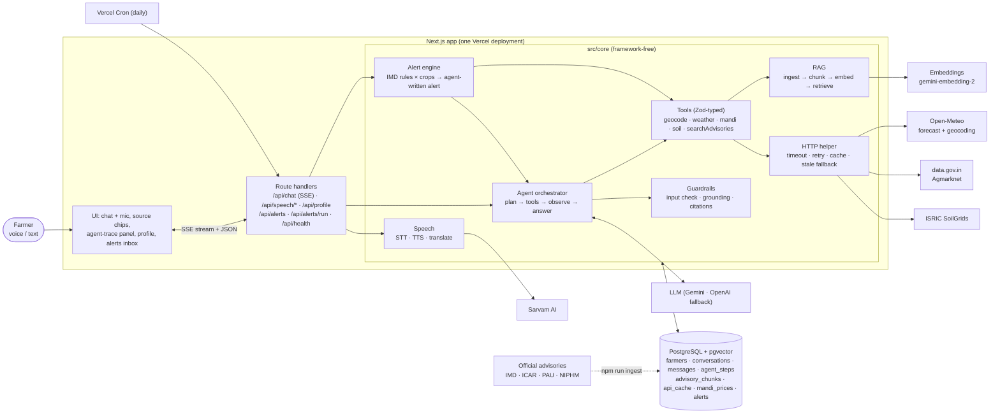
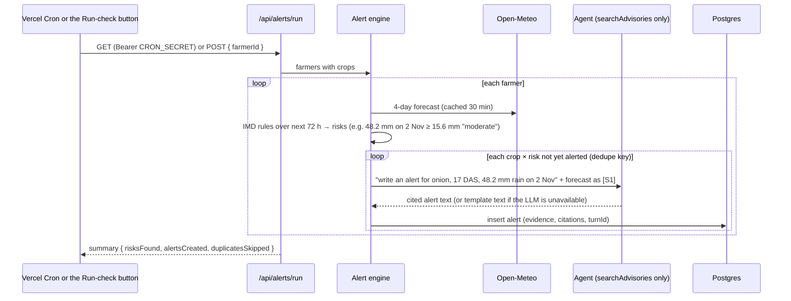

# KhetMitra (खेतमित्र)

**A voice-first farm advisor that answers in Hindi or English using live weather, live mandi prices, soil data and official agricultural advisories, cites every claim, and warns farmers *before* bad weather reaches their crop.**

Forge Gen AI Buildathon · Theme 2: *Climate, Resource Infrastructure & Global Supply Resilience* · Problem: *Multilingual Agritech & Resource Advisory Assistant*

---

## 1. Problem and users

Small and marginal farmers make high-stakes decisions every week: when to irrigate, whether to spray today, when to apply fertiliser, which mandi to sell in. Two kinds of uncertainty drive their losses:

- **Weather uncertainty.** Fertiliser or pesticide applied a day before heavy rain is washed away. A heat spell or frost at a sensitive growth stage cuts yield. Forecasts exist, but they rarely arrive as *crop-specific actions* in time.
- **Price uncertainty.** Prices for the same crop differ widely between nearby mandis and move day to day. Farmers often sell at the nearest market without seeing the alternatives.

The information exists in public systems: IMD and Open-Meteo forecasts, Agmarknet prices on data.gov.in, ICAR / state agricultural university Packages of Practices, NIPHM IPM packages and SoilGrids soil maps. But it sits in English PDFs, dashboards and spreadsheets.

**Target users:** farmers with a smartphone who are more comfortable speaking Hindi than reading English. Secondary users are extension workers and FPO staff who advise many farmers.

## 2. Solution and key features

KhetMitra is a conversational assistant. A farmer taps the mic, asks *"कल बारिश होगी? क्या आज यूरिया डालूं?"* ("Will it rain tomorrow? Should I apply urea today?"), and hears a short answer in Hindi. The answer is built from live data, and each fact links to its source.

| Feature | What it does |
|---|---|
| 🎙️ **Voice-first, multilingual** | Speak or type in Hindi or English. Speech-to-text and text-to-speech come from Sarvam AI, which is built for Indian languages, with the browser's speech engine as fallback. Any answer can be translated with one tap. |
| 🔔 **Proactive alerts (USP)** | A scheduled check runs the real forecast against each farmer's crops using IMD thresholds (heavy rain, moderate rain before inputs, heat, cold, strong wind). It warns 24–72 h *before* the event, with crop- and stage-specific actions written by the agent from official advisories. |
| 🧠 **Real agentic reasoning** | Our own agent loop. The model plans, calls tools in parallel, has its arguments validated, recovers from errors and stays within a step budget. |
| 📚 **Grounded and cited** | Every answer shows source chips: the tool plus fetch time, or the document plus section and page. A guardrail removes numbers no source supports. Doses are only allowed when they come from an official document. |
| 🔍 **Live agent trace** | A panel shows each step as it happens (model call, tool name, arguments, latency, retries, guardrail result), so judges can watch the agent work. |
| 🧑‍🌾 **Farmer profile** | Location (geocoded), crops with sowing dates (gives days-after-sowing), language, and optional Soil Health Card values (lab values are preferred over map estimates). |
| 🛡️ **Robust by design** | Every external call has a timeout, retries and a fallback. If a provider is down, the last real response is shown, labelled as cached with its fetch time. Missing keys disable only their own feature. |

## 3. Architecture



### One voice question, end to end

```mermaid
sequenceDiagram
  actor F as Farmer
  participant W as Web app
  participant STT as /api/speech/stt (Sarvam Saaras)
  participant C as /api/chat (SSE)
  participant O as Orchestrator
  participant L as LLM (Gemini)
  participant T as Tools
  participant G as Guardrail
  participant TTS as /api/speech/tts (Sarvam Bulbul)

  F->>W: "प्याज में थ्रिप्स आ गए, क्या दवा डालूं? कल बारिश तो नहीं?"
  W->>STT: audio (WebM, ≤30 s)
  STT-->>W: Hindi transcript
  W->>C: { message, language: "hi", farmerId }
  C->>O: question + profile (Lasalgaon, onion, 17 days after sowing) + history
  O->>L: system prompt + messages + tool JSON Schemas
  L-->>O: tool calls: searchAdvisories("onion thrips management"), getWeatherForecast(20.14, 74.24)
  O->>O: validate args with Zod (invalid → error back to the model)
  par in parallel, each with timeout + cache
    O->>T: searchAdvisories → pgvector top-5 NIPHM/PAU passages [S1–S5]
    O->>T: getWeatherForecast → Open-Meteo 7-day + 48 h rain summary [S6]
  end
  O-->>W: trace steps (tool, args, latency) stream live
  O->>L: tool results (data + source ids)
  L-->>O: Hindi answer citing [S2] [S6]
  O->>G: every number must appear in a source; doses only from documents
  G-->>O: verified answer (+ auto-citations, removals)
  O-->>W: final answer + source chips
  W->>TTS: answer text (citation markers stripped)
  TTS-->>W: MP3
  W-->>F: plays the answer, shows sources
```

### Proactive alert flow



## 4. How the AI works (plain language)

**Tool calling: the LLM writes the request, our code runs it.** It works like RPC. The model never touches the internet. It receives a list of tools described as JSON Schema (for example `getWeatherForecast(latitude, longitude, days)`) and answers with a structured request such as `{ name: "getWeatherForecast", args: {...} }`. Our orchestrator checks the arguments with Zod and calls the real API. It then hands back the data plus a source id (`S1`), and the model reads the result and continues.

**The agent loop: an event loop with a step budget.** Each step, the model either answers or asks for more tools. Independent tool calls run in parallel. The loop stops at 6 LLM calls or 45 s, and the last step forbids tools (`toolChoice: "none"`) so the farmer always gets an answer. Invalid arguments or a failing tool go back to the model as an error message, so it can correct itself. After 2 failed retries the tool is disabled for that turn. If the main model fails, a fallback model takes over.

**RAG: an open-book exam.** Official advisories (IMD bulletin, ICAR wheat guide, PAU Packages of Practices, NIPHM IPM packages) are downloaded and split into chunks of about 1,100 characters. Each chunk overlaps the next slightly, so a fact on a boundary isn't cut in half, and each is tagged with its crop and section ("Onion › RABI ONION › Agronomic Practices"). Every chunk is turned into a 768-number **embedding**. An embedding works like a hash that preserves meaning: similar text lands close together, even across Hindi and English. Chunks are stored in pgvector. At question time, the query is embedded and the nearest chunks are retrieved with cosine distance, filtered by crop, and the model answers only from them.

**Grounding and citations.** The system prompt requires every number to come from a tool result and every sentence to end with its source id. The guardrail then checks this in code before the answer reaches the farmer:
- every number must match a number in the evidence, rounded to the precision the model wrote
- a correct number with no citation gets one attached automatically
- a sentence with an unsupported number is removed, and the answer says that something was removed
- doses ("2 ml per litre", "@ 1.5 kg/acre") must appear in an official *document* excerpt
- invented source ids are dropped
- mandi prices are reported as observed trends only, never predictions

**Prompt injection.** Tool results and document excerpts are wrapped as data, and the prompt says to ignore any instructions inside them. The model can reach nothing but the five data tools, every argument is validated, and no tool can change a farmer's data.

**Proactive alerts.** Deterministic rules decide *whether* to alert, using official IMD rainfall classes and heat- and cold-wave criteria. That makes alerts explainable, and they can't be hallucinated. The LLM only writes the crop- and stage-specific advice, from retrieved advisories, citing the forecast that triggered it. Dedupe keys (farmer + crop + rule + day) keep the check idempotent however often it runs.

## 5. Data sources (all live; no mock data)

| Data | Source | Notes |
|---|---|---|
| Weather forecast | [Open-Meteo Forecast API](https://open-meteo.com/en/docs) | Daily rain (mm, %), Tmin/Tmax, wind/gusts, ET₀, humidity; hourly rain for the next 48 h. No key. Cached 30 min per ~1 km cell. |
| Geocoding | [Open-Meteo Geocoding](https://open-meteo.com/en/docs/geocoding-api) (GeoNames) | Latin-script names only (verified: Devanagari returns nothing), so the agent transliterates. Diacritics and "District" suffixes are folded to match Agmarknet spellings. |
| Mandi prices | [data.gov.in OGD API](https://data.gov.in/resource/current-daily-price-various-commodities-various-markets-mandi), Agmarknet: *Current Daily Price of Various Commodities from Various Markets* (`9ef84268-d588-465a-a308-a864a43d0070`) | Rs/quintal, min/max/modal, arrival date. History comes best effort from *Variety-wise Daily Market Prices* (`35985678-0d79-46b4-9ed6-6f13308a1d24`), plus every real row KhetMitra fetches, stored in `mandi_prices`. Trends are computed from that history and are **observed only**. |
| Soil | [ISRIC SoilGrids v2.0](https://rest.isric.org) + the farmer's **Soil Health Card** values | SoilGrids is a beta service (it returned 503 during verification). Cached 30 days and combined with lab values from the profile when present. |
| Advisories (RAG) | IMD [National Agromet Advisory Bulletin](https://mausam.imd.gov.in/imd_latest/contents/agromet/advisory/national_english_current.php) (current); ICAR-DWR *Wheat Cultivation in India*; PAU *Package of Practices*: Rabi, Kharif, Vegetables (crop chapters only); NIPHM *IPM Packages* for wheat, rice, onion, tomato, potato, mustard | URLs and metadata live in [`config/advisory-sources.ts`](config/advisory-sources.ts). Content is fetched by `npm run ingest`. |
| Thresholds | IMD 24-h rainfall classes (moderate ≥15.6, heavy ≥64.5, very heavy ≥115.6 mm); IMD heat wave (≥40 °C plains baseline, ≥45 °C absolute); IMD cold wave (≤4 °C); Beaufort force 6 (≥39 km/h) | Official definitions, cited in each alert's evidence. |
| Speech | [Sarvam AI](https://docs.sarvam.ai): Saaras v4 (STT), Bulbul v3 (TTS), Sarvam-Translate v1 (translation, formal Hindi) | Browser Web Speech API fallback. |

**No-mock-data guarantee.** Runtime code and seed scripts contain no datasets, sample prices, weather values or placeholder records (there is no seed script at all). Test fixtures live only in `**/__tests__/`, and an ESLint rule (`no-restricted-imports`) fails the build if runtime code imports them. When a source is down, KhetMitra shows the last **real** response labelled "cached" with its original fetch time, or says plainly that the data is unavailable.

**Verification status (1 Nov 2026).** Every live source was checked with real calls and real keys: Open-Meteo, data.gov.in (current and historical Agmarknet resources), Sarvam STT/TTS/translation, Gemini (model access and embeddings) and all 11 advisory PDFs. SoilGrids was returning 503 throughout, which the soil tool handles. Rerun `npm run probe` at any time; results are in [`docs/PROBE_RESULTS.md`](docs/PROBE_RESULTS.md).

## 6. Tech stack

| Layer | Choice |
|---|---|
| Language | TypeScript 5 (`strict`, `noUncheckedIndexedAccess`) on Node.js 24 LTS |
| App | Next.js 16.4 (App Router, Turbopack), React 19 |
| UI | Tailwind CSS 4, shadcn/ui (Radix), lucide icons, Geist + Noto Sans Devanagari |
| LLM transport | Vercel AI SDK 7 (`ai`, `@ai-sdk/google`, `@ai-sdk/openai`) under **our own** orchestrator |
| Models | Gemini `gemini-3.8-flash` (primary), `gemini-3.5-flash-lite` (fallback); OpenAI `gpt-6.1-terra` / `gpt-6-luna` via `LLM_PROVIDER=openai` |
| Embeddings | `gemini-embedding-2` at 768 dims (or `text-embedding-3-small` at 768) |
| Database | PostgreSQL 17 + pgvector 0.8 (HNSW cosine index); Neon in production, Docker locally |
| ORM | Prisma 7 (driver adapter `@prisma/adapter-pg`); vectors via `Unsupported("vector(768)")` + `$queryRaw` |
| Validation | Zod 4 at every boundary (env, request bodies, tool args, API responses) |
| Speech | Sarvam AI REST (+ Web Speech API fallback) |
| Documents | `unpdf` (PDF text), `node-html-parser` |
| Tests | Vitest 5 (51 tests) |
| Deploy | Vercel (+ Vercel Cron) and Neon |

## 7. Project structure

```
src/
  app/                    pages + thin route handlers (parse → call core → respond)
    api/chat/             POST → SSE stream of agent events
    api/speech/           stt · tts · translate (fall back to the browser on failure)
    api/alerts/           list / mark read · run/ (cron GET + "check now" POST)
    api/profile/          create / read the farmer profile
    api/geocode/          place search for the profile form
    api/health/           database + provider status
    api/_lib/             SSE, JSON errors, rate limiting
  components/             chat (composer, mic, answers, source chips), trace panel,
                          alerts inbox, profile form, app shell, health indicator
  core/                   framework-free domain + AI logic
    agent/                orchestrator loop, LLM client, providers/models, prompts/, chat service
    tools/                one folder per tool: schema.ts · client.ts · index.ts
    rag/                  parse, chunk, embed, ingest, retrieve
    guardrails/           input checks, grounding/citation guardrail
    speech/               Sarvam STT / TTS / translation
    alerts/               IMD rules, alert engine, templates, service
    profile/              profile + Soil Health Card schemas
    lib/                  env (Zod), errors, logger, HTTP helper (timeout/retry/cache), format
    container.ts          composition root (the only place concrete providers are chosen)
    health.ts             health report
  db/                     Prisma client, raw vector SQL, repositories, cache store
  lib/                    browser-side helpers: speech, SSE reader, i18n, utils
config/                   supported crops, languages, advisory source URLs
prisma/                   schema.prisma, migrations (pgvector extension + HNSW index)
scripts/
  probe/                  one real call per external API (npm run probe)
  ingest-advisories.ts    RAG ingestion (npm run ingest)
  run-tool.ts             call any agent tool from the CLI (npm run tool)
docs/PROBE_RESULTS.md     what each API actually returned when verified
```

## 8. Setup

### Prerequisites
- Node.js 24 (LTS) and npm
- Docker Desktop (for local Postgres + pgvector), or a [Neon](https://neon.tech) database
- API keys: see the table below. Missing keys only disable their feature.

### Install and run locally
```bash
git clone <your-repo-url> khetmitra && cd khetmitra
npm install                       # also runs `prisma generate`
cp .env.example .env              # then fill in the keys
docker compose up -d              # Postgres 17 + pgvector on localhost:5433
npm run db:migrate                # creates tables, pgvector extension, HNSW index
npm run ingest                    # downloads + embeds the official advisories (needs the LLM key)
npm run dev                       # http://localhost:3000
```

The local database listens on host port **5433**, so it never collides with a PostgreSQL already installed on 5432.

Useful checks:
```bash
npm run probe                     # one real request to every external API, with a summary
npm run ingest -- --dry-run       # fetch + parse + chunk all documents without keys or a DB
npm run tool -- getWeatherForecast '{"latitude":20.14,"longitude":74.24,"days":3}'
curl localhost:3000/api/health    # which providers are configured / reachable
```

### Environment variables

| Name | Purpose | Where to get it |
|---|---|---|
| `DATABASE_URL` | Postgres connection (required) | Local: value in `.env.example`. Production: Neon → Connection string (use the **pooled** one) |
| `LLM_PROVIDER` | `google` (default) or `openai` | — |
| `GOOGLE_GENERATIVE_AI_API_KEY` | Gemini chat + embeddings | [Google AI Studio](https://aistudio.google.com/apikey) |
| `OPENAI_API_KEY` | OpenAI (if provider/fallback is `openai`) | [platform.openai.com](https://platform.openai.com/api-keys) |
| `LLM_MODEL`, `LLM_FALLBACK_PROVIDER`, `LLM_FALLBACK_MODEL` | Optional model overrides | defaults in `src/core/agent/models.ts` |
| `EMBEDDING_PROVIDER`, `EMBEDDING_MODEL` | Optional; changing them requires `npm run ingest -- --force` | — |
| `DATA_GOV_IN_API_KEY` | Agmarknet mandi prices | [data.gov.in](https://data.gov.in) → sign in → My Account → API key |
| `MANDI_RESOURCE_ID` | Optional override of the Agmarknet resource | — |
| `SARVAM_API_KEY` | Speech-to-text, text-to-speech, translation | [dashboard.sarvam.ai](https://dashboard.sarvam.ai) (redirects to indus.sarvam.ai) → API Keys |
| `CRON_SECRET` | Protects the scheduled alert route (≥16 chars) | `openssl rand -hex 32` |
| `LOG_LEVEL` | `debug` / `info` / `warn` / `error` | — |

At startup the server logs one line per disabled feature, naming the missing variable. A malformed value (for example a non-Postgres URL) fails fast with a list of problems.

## 9. Deployment (Vercel + Neon)

1. **Database:** create a Neon project (pick a region close to India). From your machine, run `DATABASE_URL="<neon pooled url>" npm run db:migrate`, then `DATABASE_URL="<neon url>" npm run ingest`. The migration enables `vector` itself.
2. **Vercel:** import the repository. The build command is the default `npm run build` (`prisma generate && next build`). Add every variable from the table above in *Settings → Environment Variables*.
3. **Region:** for lower latency to Indian APIs and users, set the function region to Mumbai (`bom1`) in *Settings → Functions*.
4. **Cron:** `vercel.json` schedules `GET /api/alerts/run` daily at 00:30 UTC (06:00 IST, before field work). Vercel sends `Authorization: Bearer $CRON_SECRET`. The Hobby plan allows **one run per day**; on Pro you can change the schedule to `0 */3 * * *`. The in-app **Run alert check now** button works on any plan.
5. Open `/api/health` on the deployment to confirm every check is green.

## 10. API routes

| Method | Route | Purpose |
|---|---|---|
| `POST` | `/api/chat` | `{ message, language, conversationId?, farmerId? }` → `text/event-stream` of `turn_start`, `step`, `text_delta`, `text_reset`, `final`, `error`. Rate-limited per client. |
| `POST` | `/api/speech/stt` | multipart `audio` (≤30 s) + `language` → `{ text }`. 503 `{ fallback: "browser" }` when unavailable. |
| `POST` | `/api/speech/tts` | `{ text, language }` → `{ audioBase64, mimeType }` (MP3). Citation markers stripped. |
| `POST` | `/api/speech/translate` | `{ text, from, to }` → `{ text }`, keeping `[S#]` citation markers intact. |
| `GET` / `POST` | `/api/profile` | Read (`?id=`) / create-or-replace the farmer profile. |
| `GET` | `/api/geocode?q=` | Place search for the profile form. |
| `GET` / `PATCH` | `/api/alerts` | List a farmer's alerts / mark them read. |
| `GET` | `/api/alerts/run` | Vercel Cron: checks every farmer (`Authorization: Bearer $CRON_SECRET`). |
| `POST` | `/api/alerts/run` | "Run alert check now" for one farmer (`{ farmerId }`, 15 s cooldown). |
| `GET` | `/api/health` | Database, LLM, advisory index, Open-Meteo, SoilGrids, data.gov.in and Sarvam status (cached 60 s; `?fresh=1`). |

## 11. Testing

```bash
npm test            # Vitest: 51 tests
npm run typecheck   # next typegen + tsc --noEmit
npm run lint        # ESLint (includes the "no fixtures in runtime code" rule)
npm run build       # production build
```

The suite covers the **orchestrator**: argument self-correction, tool disabling after repeated failures, missing keys, the step budget with a forced final answer, parallel tool execution, model fallback, total LLM failure, unknown tools, fabricated-number removal and pre-fetched context. It also covers the **grounding guardrail** (precision-aware number matching, auto-citation, document-only doses, Devanagari digits, invented ids, language mismatch), **chunking** (headings, hyphenation, overlap, section boundaries, long units), the **HTTP helper** (retry policy, timeouts, stale cache, schema mismatch, credential redaction), **IMD alert rules**, **tool argument schemas**, **Agmarknet parsing** and **trend analysis**.

The LLM is replaced in tests by a scripted fake (`src/core/agent/__tests__/fake-llm.ts`), so the loop's behaviour is tested deterministically and offline.

## 12. Robustness and edge cases

| Situation | Behaviour |
|---|---|
| Provider slow or down | Per-attempt timeout; bounded retries with exponential backoff and jitter (idempotent calls only, `Retry-After` honoured). Then the last real response, labelled *cached* with its fetch time, or a clear "unavailable" message. |
| Tool fails during a turn | The error goes back to the model with guidance. After 2 retries the tool is disabled and the model answers with what it has, saying what is missing. |
| LLM error or timeout | SDK retry, then the fallback model, then a friendly message with the Kisan Call Centre number. |
| Turn running long | 45 s budget; per-call timeouts shrink to fit inside the 60 s function limit; the final step must answer. |
| Empty, garbage or over-long input | Answered instantly without an LLM call, in the farmer's language. |
| Off-topic question | The prompt rule politely declines non-farming questions. |
| Unknown or misspelled place | The geocoder returns no match; the agent asks for the nearest town or district. |
| Unsupported crop | Weather and mandi tools still work. The agent says official guidance for that crop isn't in the library and suggests the KVK. |
| Mic permission denied / no mic / unsupported browser | Clear message; typing always works. |
| Speech service failure | STT falls back to the browser recognizer; TTS falls back to `speechSynthesis`; the text answer is always shown. |
| Missing env var | Only that feature is disabled; the startup log and `/api/health` name the variable. |
| Database down | Chat still answers (without history or persistence); the health indicator turns red. |
| Rendering bug | The error boundary shows a recoverable screen. |
| Repeated alert runs | Dedupe keys make the check idempotent; the manual button has a cooldown. |

## 13. Roadmap

- **WhatsApp and IVR** channels for farmers without smartphones, reusing the same `/api/chat` agent.
- **More languages:** Marathi, Punjabi, Tamil, Telugu and others (Sarvam already supports 22 Indian languages).
- **SMS / push alerts** in addition to the in-app inbox.
- **Satellite crop health:** NDVI from ISRO Bhuvan / Sentinel-2 as a tool, to detect stress before it is visible.
- **District agromet bulletins** (IMD / GKMS) and KVK contacts by district.
- **Soil Health Card integration** by card number, instead of manual entry.
- **Evaluation set** of real farmer questions run in CI against the agent.

## 14. Team and license

**Team:** _add names, colleges and roles here._

Released under the [MIT License](LICENSE).
